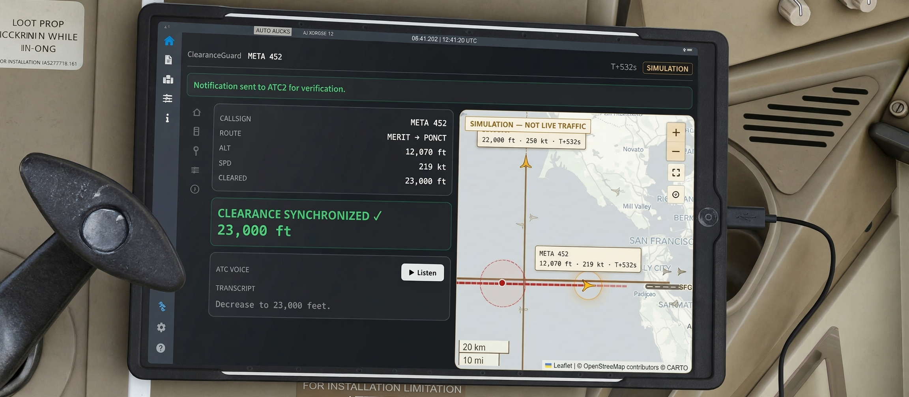
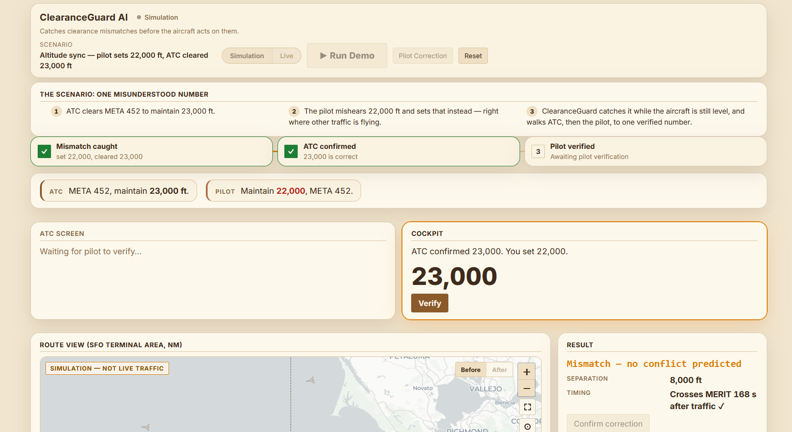
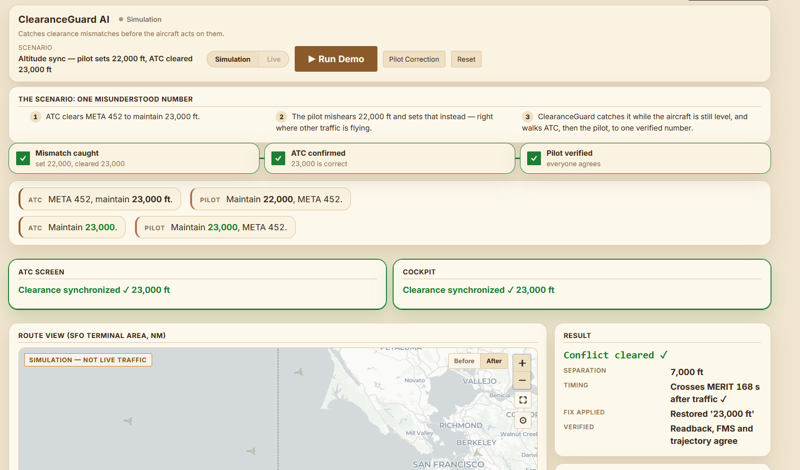
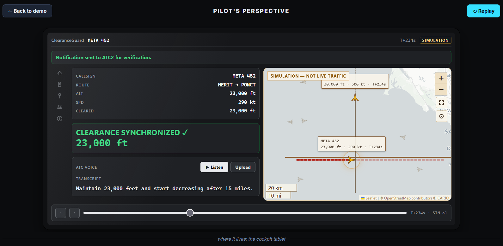
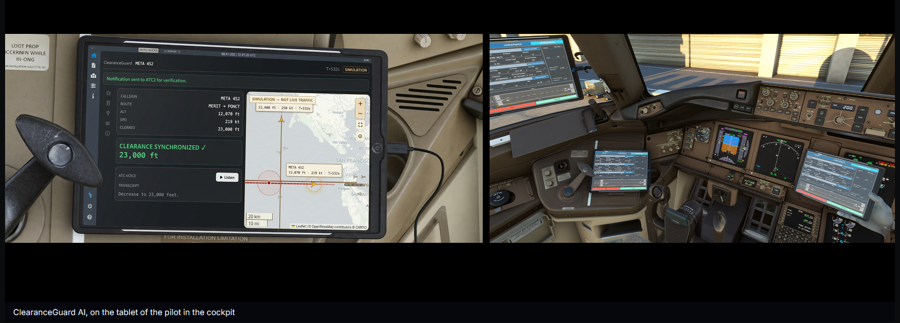

# ClearanceGuard AI

Catches misheard ATC clearances before they become deviations.

> **Demo video:** [3-minute walkthrough — demo + pilot's perspective](https://youtu.be/6DkMgs8Sa14)



About 1 in 4 accidents involves pilot-ATC miscommunication (ICAO/FAA) — and
the deadliest crash in history, Tenerife, started with a misunderstood radio
call. ClearanceGuard AI listens to every clearance, compares the ATC
instruction, the pilot readback, and the FMS entry, and the instant they
disagree it raises the flag and walks the crew to a verified fix.

## What it does

A safety net for misheard clearances: hear everything, check three ways,
fly only verified fixes.

- Catches misheard ATC clearances before they become deviations
- Compares ATC, pilot readback, and FMS — flags mismatches instantly
- Verifies the fix, then walks ATC and pilot through confirmation
- Runs live on a cockpit tablet, voice included

## The demo in 60 seconds

ATC clears META 452 to **maintain 23,000 feet** — but the pilot mishears it,
sets **22,000**, and programs the flight computer. ClearanceGuard:

1. Reads all three sources (clearance, readback, FMS) and raises a
   **mismatch flag** instantly.
2. Predicts the flight path forward in 4D against surrounding traffic.
3. Proposes a correction it has **already verified as safe** (restore 23,000).
4. ATC confirms, the pilot verifies — **clearance synchronized**, all agree.

Then flip to **Pilot's Perspective**: the same loop running live on a cockpit
tablet — gray EFB styling, moving map, the aircraft holding 23,000 through
the encounter. Drop in an ATC voice recording and the tablet transcribes it
and builds the same safety check at the new altitude automatically.

## Features

- **Mismatch detection** across ATC intent, pilot readback, and simulated FMS
  (changed values, dropped conditions, nine finding categories).
- **4D conflict prediction** over both aircraft plus a counterfactual safety
  window (last safe correction time, causal chain).
- **Verified resolutions only**: candidates are enumerated, independently
  verified (comparison agrees, no conflict), then applied on explicit pilot
  confirmation. Nothing auto-flies the airplane.
- **Pilot tablet view**: 50/50 split — live interactive tablet on top,
  cockpit context below.
- **Voice upload**: ATC audio transcribed into a custom clearance scenario
  (typed fallback when offline).
- **Offline-first, Live AI optional**: deterministic local parsing and
  scripted coordination with zero setup; flip on Live to run parsing,
  explanation, and coordination through Meta's model API. Every result
  carries a provenance badge (`Live Meta API` vs `Fixture fallback`).
- **Auditability**: SHA-256 intent fingerprints plus a hash-linked audit
  chain — every decision replayable.

## Screenshots









## Quickstart

Prereqs: Python 3.12+, Node 18+.

```powershell
# Backend (terminal 1)
python -m venv .venv
.venv\Scripts\Activate.ps1
pip install -r backend\requirements.txt
copy .env.example .env   # optional: set MODEL_API_KEY for Live mode
cd backend
uvicorn app.main:app --port 8000
```

```powershell
# Frontend (terminal 2)
cd frontend
npm install
npm run dev
```

Open http://localhost:5173 (API health: http://127.0.0.1:8000/health).
No key needed — the full demo runs offline on deterministic fixtures.

For Live mode, set `MODEL_API_KEY` in `.env` (endpoints default to the
official Meta URLs; see `.env.example`) and toggle **Live** in the demo.

## Architecture

```text
ATC clearance --\
                 +--> compare (matrix) --> predict (4D) --> verify --> apply
Pilot readback -> FMS sim --/                |                 |
Voice / typed ------------------------------------------------+
```

- AI interprets language and explains; deterministic Python compares and
  predicts. Nothing edits or controls the aircraft — correction is an
  explicit simulated pilot action.
- Clearances use a fixed, non-recursive `ClearanceAction` list (DIRECT_TO,
  CLIMB, DESCEND, MAINTAIN, SPEED, HEADING, HOLD) with triggers
  (IMMEDIATE, AFTER_WAYPOINT, AT_WAYPOINT, AT_TIME).
- State is in-memory only; `POST /api/session/reset` clears it.

Key endpoints: `/api/demo/run`, `/api/demo/run-custom` (voice),
`/api/demo/correct`, `/api/safety/window`, `/api/resolutions/enumerate`,
`/api/resolutions/verify`, `/api/fingerprints`, `/api/coordinate`,
`/api/voice/transcribe`, `/api/scenarios`, `/api/audit/events`.

## Meta model usage

- `muse-spark-1.3`: ATC Intent, Pilot Understanding, Verification
  Explanation agents. Strict JSON schemas validated with Pydantic; missing
  values stay null — never inferred.
- `muse-voice-transcribe-1.0`: prerecorded WAV transcription; typed input
  remains as fallback.
- Only `MODEL_API_KEY` is required (`META_API_KEY` still works as legacy).
  Any live failure degrades to labelled fixtures, never silent guesses.

## Tests

```powershell
# Backend (101 tests, offline)
.venv\Scripts\python -m pytest backend\tests -q

# Frontend (197 tests + typecheck)
cd frontend
npm test
npm run typecheck
```

Live smoke checks (need `MODEL_API_KEY`; fail loudly on fixture fallback):

```powershell
.\.venv\Scripts\python backend\scripts\live_smoke.py
.\.venv\Scripts\python backend\scripts\voice_smoke.py <path-to-24khz-mono-wav>
.\.venv\Scripts\python backend\scripts\coordinator_smoke.py
```

## Safety limitations

Prototype for demonstration only: flat-plane demo geography, simplified FMS
and separation minima. Not for operational use. The AI never commands the
aircraft; a real deployment would be certified avionics-adjacent software
(DO-178C processes), fully deterministic offline, wired into the FMS and
radios.

## Layout

```text
backend/    FastAPI API + agents, FMS sim, prediction, safety, audit
frontend/   React + Vite demo UI, pilot tablet, maps, charts (Vitest suite)
docs/       Handoff document
scripts/    Doc generators
```

See LICENSE.
